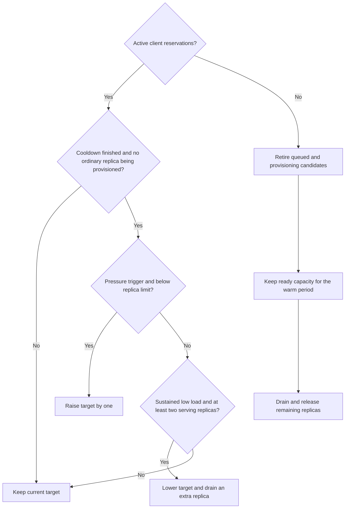

# How the manager adds and releases capacity

The objective is useful GPU occupancy and responsible use of shared clusters,
not primarily lower latency. The current prototype uses request-load heuristics
to decide whether to add or consolidate model servers. These are proxies for
demand, **not measurements of GPU utilization or proof of policy compliance**.

This page describes the implementation in PR #8, reviewed at `e13ec865`. It does
not change the policy. The known gaps are tracked in
[issue #9](https://github.com/alessandrocornacchia/sserve/issues/9).

## Terms and limits

A **replica** is a complete, independent model server. Adding a replica does not
change the model's precision, context settings or GPUs per server.

The **target** is the number of replicas the manager wants. It is not the number
already available: allocation budgets, queues and startup can delay it.

Each replica position can race candidate jobs on approved profiles. Those
candidates are alternative ways to obtain one replica, not additional desired
replicas. The first ready candidate wins and its unused siblings are cancelled.

## Policy at a glance



With active reservations, the current target has a floor of one. A new deployment
starts with that target; returning demand can reuse an older target, as noted
under [known gaps](#known-gaps-and-proposals).

## Scale-out: two independent pressure triggers

The manager uses either a complete metrics window or repeated backend overload
failures. The defaults are a five-minute window and checks approximately every
15 seconds. Slow scheduler or network operations can make checks less frequent.

### Trigger A: sustained queue or cache pressure

At **every observed sample** in a complete five-minute window, at least one of
these conditions must hold:

```text
total waiting requests / number of serving replicas >= 2

OR

at least one replica has BOTH:
    KV-cache usage >= 90%
    waiting requests > 0
```

The first condition averages queue length across replicas, not across time. A
single observation below both thresholds breaks the sustained-pressure condition.
The two conditions may alternate across samples; it need not be the same queued
request or the same hot replica throughout.

For the cache branch, the high cache usage and waiting request must occur on
the same replica. A full cache on an otherwise quiet server is not sufficient.

**Example:** one replica with two requests waiting at every sample for five
minutes qualifies. One waiting request qualifies through the cache branch only
if its replica also has at least 90% KV-cache occupancy at those samples, or the
other pressure condition covers the remaining samples.

**Rationale:** waiting work suggests unmet demand, while a full cache alone may
simply reflect retained or long-context data. However, even cache pressure plus
a small queue does not establish that another GPU allocation will be usefully
occupied. This part of the policy remains under review for the utilization-first
objective.

### Trigger B: repeated backend overload failures

Five backend-reported 429 or 503 failures in the last five minutes also qualify.
They need not span the whole window, and valid metrics are not required for this
trigger. A short burst of five failures can therefore qualify sooner.

These are failed client requests after routing retries, not a count of every
internal retry. Connection errors, timeouts, malformed requests, authentication
errors and the manager's own no-capacity response do not count as overload.
Connectivity problems are handled by connection and health recovery instead.

**Rationale:** rejected real work is an alternative pressure signal. It is still
a heuristic; a reported overload is not a GPU-utilization measurement.

### Gates before increasing the target

Either trigger raises the target by one only when no ordinary replica position
is already provisioning, the model limit permits growth, and the cooldown has
expired. Provisioning another position before the previous one is resolved
would risk accumulating duplicate capacity.

The default cooldown is ten minutes after a target change. It is persisted
across manager restarts; a new deployment has no previous change to cool down
from. Submission and GPU budgets can still prevent the new target from becoming
an allocated job.

## Scale-in: consolidate sustained low load

With active reservations, scale-in requires all of the following:

- At least two serving replicas and a target above one.
- A complete, valid five-minute metrics window.
- No counted overload failures in that window.
- No ordinary replica position still provisioning.
- The ten-minute cooldown has expired.

Let `N` be the number of serving replicas. The load test is:

```text
peak total (running + waiting requests) in the window
    <= (N - 1) * down_load_per_replica
```

`down_load_per_replica` defaults to one. For two serving replicas, the total
number of running or waiting requests must therefore stay at most one throughout
the window before the target shrinks to one. For three serving replicas, the
corresponding default threshold is two.

This is observed concurrency, not a workload forecast or a learned estimate of
server capacity. Empty queues alone do not qualify: servers may be busy executing
requests. Conversely, request counts do not capture differences in context length
or computational cost.

**Rationale:** consolidate clearly sparse demand instead of retiring a server
during a brief lull. Different growth and shrink conditions, together with the
cooldown, reduce repeated add/remove cycles. Actual GPU telemetry is still needed
to validate how well this proxy meets the cluster's utilization objective.

The target normally shrinks by one. The calculation uses serving replicas, so it
can differ from that simple step if the stored target and serving count differ.
When a position must be retired, provisioning positions are preferred; otherwise
the serving position with the least remaining walltime is selected.

## Draining is different from immediate cancellation

A retiring server is removed from routing, so new requests go elsewhere. Its
existing requests may finish before its job is cancelled. The default deadline
is 15 minutes from retirement; requests still active at that deadline can be
interrupted. Unused non-winning candidates are cancelled without this serving
drain.

The manager uses tracked in-flight requests for draining. It does not equate an
empty queue with proof that a long response has finished.

## Releasing the last replica

Load-based consolidation can repeat from four replicas to three, two and one.
Mathematically, zero running and queued requests would also satisfy the default
test for one to zero. **The implementation explicitly prevents that transition
while active reservations remain.**

Zero serving capacity is reached through reservation release, expiry or
inactivity instead:

1. With no active reservations, queued and provisioning positions are retired;
   they are not held through the warm period.
2. Ready servers may stay for a default ten-minute warm period for reuse. There
   is no new scaling or walltime replacement during this period.
3. After the warm period, remaining servers drain and their owned jobs are
   cancelled. Set `leases.linger_s = 0` to skip the warm period.

Reservations default to a five-minute renewable expiry. Preparation grace starts
at first availability, not while waiting for capacity. The default preparation
grace and inference-idle interval are 30 minutes each. A request still in flight
protects against idle retirement; renewals and health probes are not inference
activity. See the [client guide](manager.md#when-work-endsor-stops-making-requests).

The policy does not yet support keeping an active reservation while deliberately
sleeping at zero replicas and waking on a new inference request. That would need
an explicit wake-up policy so the reservation itself does not immediately cause
another allocation.

## Missing telemetry and manager restarts

The metrics window requires running and waiting request counts from every
serving replica. A failed scrape or probe makes the window incomplete and blocks
metric-based growth and shrink decisions until valid history is rebuilt.
Repeated backend overload failures can still trigger growth independently.

Missing KV-cache data does not invalidate otherwise valid request counts; it
simply cannot activate the cache-pressure branch. Do not interpret that as
evidence of low cache usage.

Metrics samples and overload history are in memory and are rebuilt after a
restart. The replica target and last scaling time are persistent. It therefore
normally takes another full window to make metric-based decisions after restart
or after a new serving replica joins.

## Allocation budgets and walltime renewal

The shipped example differs from some package defaults:

| Setting | Package default | Shipped example |
|---|---:|---:|
| Metrics window | 5 minutes | 5 minutes |
| Cooldown | 10 minutes | 10 minutes |
| Replica limit per model | 2 | Qwen: 1; Ornith: 2 |
| Global GPU-request budget | 16 | 8 |
| Duplicate candidates' startup-GPU budget | 8 | 4 |
| Candidate profiles per replica position | 3 | 3 |
| Daily submissions per deployment | 12 | 12 |

The global budget counts queued as well as running candidate requests. Per-profile
limits and retry controls apply too. The duplicate-startup budget applies to
additional candidates of a position that are running but not ready; it is not a
limit on all serving GPUs.

Walltime renewal is **not scale-out**. With recent real inference activity, the
manager can request a replacement during the last 30 minutes of a serving job.
Only one replacement is pursued at a time. When it is ready, the old server
drains. This can temporarily exceed the normal replica target by one while still
remaining subject to the allocation budgets.

A policy or repeated-startup block prevents further submissions and replacements;
already ready replicas can continue serving. An operator must resolve the cause
and reset the block. Never reset it merely to repeat underused work.

## Known gaps and proposals

[Issue #9](https://github.com/alessandrocornacchia/sserve/issues/9) records the
current review findings. In particular:

- Promoted replacements disappear from the daily replacement counter, so that
  configured replacement limit is not correctly enforced. Other submission and
  GPU limits still apply.
- An old target can survive inactivity and start extra replicas when demand
  returns, without fresh pressure evidence.
- A provisioning position blocked by allocation budgets can stall later scaling
  decisions. A blocked model can also change its stored target despite being
  unable to obtain new capacity.
- Metrics series are combined by sample position rather than exact timestamps.
  Irregular or unequal sampling makes the combined window approximate.

These are implementation limitations, not recommended behavior. Changing to
GPU-utilization thresholds, adding a utilization forecast, or allowing load-based
one-to-zero scaling are **not implemented policy changes**. The current direction
is to retain simple load-based consolidation while validating its effectiveness
with real GPU telemetry, rather than assume a predictive controller is necessary.

For the implementation, see [scaling and lifecycle decisions](../sserved/manager.py),
[default settings](../sserved/config.py), and
[the example configuration](../examples/sserved.example.toml). The
[operator guide](manager-operator.md#live-validation-status-25-october-2026)
separates simulated validation from the live cluster check that did not receive
a GPU allocation.
